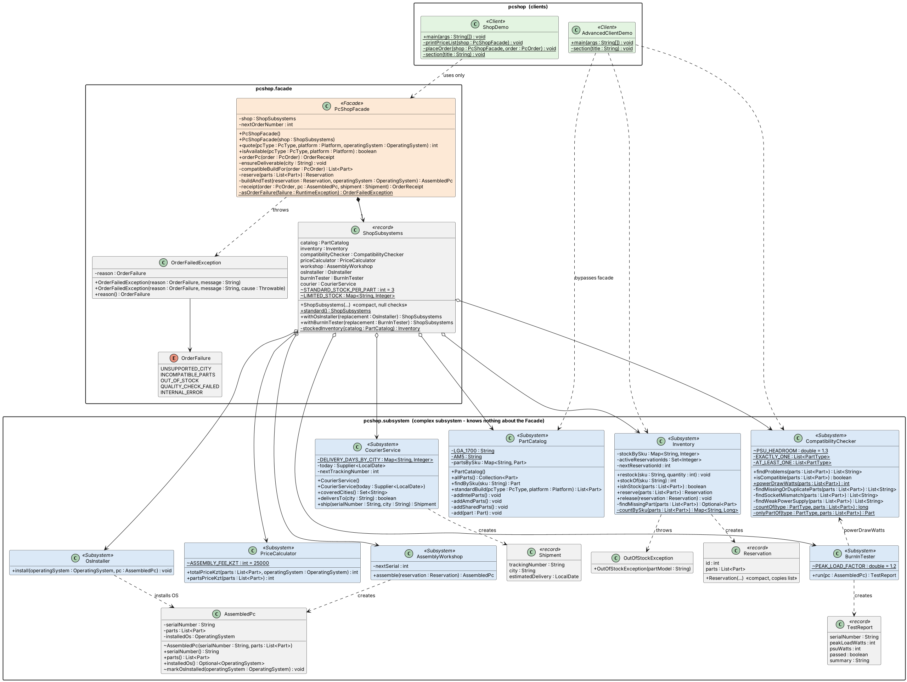
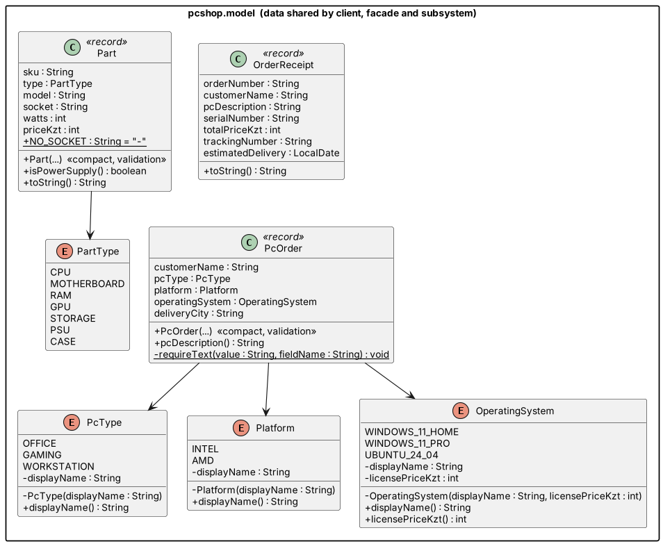

# Assignment #4 — Facade Pattern

**Course:** ShP-2216 – Software Design Patterns (OP 6B06102)
**Topic:** Option C (free topic) — **PC shop order Facade**. Continues my PC project:
Builder (A1) → Factory Method / Abstract Factory (A2) → Bridge (A3) → **Facade (A4)**.

## Idea

Ordering a computer from a shop is not one action. Behind "I want a gaming PC on AMD"
there are eight separate jobs that must happen in the right order:

1. `CourierService` — can we deliver to that city at all?
2. `PartCatalog` — which parts make up this build?
3. `CompatibilityChecker` — CPU and motherboard sockets match, PSU is strong enough?
4. `Inventory` — reserve the parts (all-or-nothing)
5. `AssemblyWorkshop` — assemble, assign a serial number
6. `OsInstaller` — install the chosen OS
7. `BurnInTester` — stress test; a failed PC is not shipped
8. `CourierService` + `PriceCalculator` — book delivery, build the receipt

If anything fails after step 4, the reserved parts must go back on the shelf.

`PcShopFacade` hides all of that behind three methods:

```java
PcShopFacade shop = new PcShopFacade();
int price      = shop.quote(PcType.GAMING, Platform.AMD, OperatingSystem.WINDOWS_11_HOME);
boolean inStock = shop.isAvailable(PcType.GAMING, Platform.AMD);
OrderReceipt r = shop.orderPc(new PcOrder("Bekzat", PcType.GAMING, Platform.AMD,
                                          OperatingSystem.WINDOWS_11_HOME, "Almaty"));
```

| Role | Class |
|---|---|
| Facade | `facade.PcShopFacade` |
| Subsystem (8 classes) | `PartCatalog`, `Inventory`, `CompatibilityChecker`, `PriceCalculator`, `AssemblyWorkshop`, `OsInstaller`, `BurnInTester`, `CourierService` |
| Subsystem data | `AssembledPc`, `Reservation`, `TestReport`, `Shipment`, `OutOfStockException` |
| Facade helpers | `ShopSubsystems` (parameter object with the 8 subsystems), `OrderFailedException`, `OrderFailure` |
| Shared data | `model.PcOrder`, `model.OrderReceipt`, `model.Part`, enums |
| Client | `ShopDemo` — uses **only** the Facade |
| Advanced client | `AdvancedClientDemo` — uses subsystem classes directly (allowed by the pattern) |

Subsystem classes never import anything from `pcshop.facade` — no back-references.

## Project structure

```
src/pcshop/
├── ShopDemo.java                 # Client (Facade only)
├── AdvancedClientDemo.java       # Advanced client (bypasses the Facade)
├── facade/
│   ├── PcShopFacade.java         # FACADE
│   ├── ShopSubsystems.java
│   ├── OrderFailedException.java
│   └── OrderFailure.java
├── subsystem/
│   ├── PartCatalog.java  Inventory.java  CompatibilityChecker.java  PriceCalculator.java
│   ├── AssemblyWorkshop.java  OsInstaller.java  BurnInTester.java  CourierService.java
│   └── AssembledPc.java  Reservation.java  TestReport.java  Shipment.java  OutOfStockException.java
└── model/
    └── Part.java  PartType.java  PcType.java  Platform.java  OperatingSystem.java  PcOrder.java  OrderReceipt.java
test/
├── pcshop/PcShopFacadeTest.java  # 24 checks through the Facade
├── pcshop/SubsystemTest.java     # 17 checks on subsystem classes directly
└── testutil/Check.java           # same tiny assert helper as in A2/A3
uml/
├── facade.puml / Facade.png      # Facade + subsystem + clients
└── model.puml  / Model.png       # shared data classes
```

## Run

Java 17+, no Maven/JUnit needed.

```bash
javac -d out $(find src test -name "*.java")
java -cp out pcshop.ShopDemo
java -cp out pcshop.AdvancedClientDemo
java -cp out pcshop.PcShopFacadeTest
java -cp out pcshop.SubsystemTest
```

`ShopDemo` shows a price list, three successful orders, an out-of-stock order
(only one RTX 4080 SUPER in the warehouse) and an order to a city the courier doesn't cover.

## UML




Every method in the code is listed in the diagrams (constructors and private helpers included).

## Clean Code principles applied

1. **Meaningful names** — `orderPc`, `quote`, `isAvailable`; `PSU_HEADROOM`, `ASSEMBLY_FEE_KZT` instead of magic numbers.
2. **Functions do one thing (ch. 3)** — `orderPc` reads as a list of steps; each step is its own small private method.
3. **Few arguments (ch. 3)** — `PcOrder` and `ShopSubsystems` are parameter objects.
4. **Exceptions, not error codes; no leaking (ch. 3/7)** — subsystem exceptions become one `OrderFailedException` with a reason; parts are released on failure.
5. **Command–query separation (ch. 3)** — `quote`/`isAvailable`/`stockOf` never change state; `reserve`/`release` don't answer questions.
6. **Objects vs data structures, Law of Demeter (ch. 6)** — client gets an `OrderReceipt` record, never a subsystem object.
7. **Single Responsibility** — the Facade coordinates; every rule (price, socket match, stock) lives in its subsystem class.

## Author

Bekzat Amanbek — SE-2503
